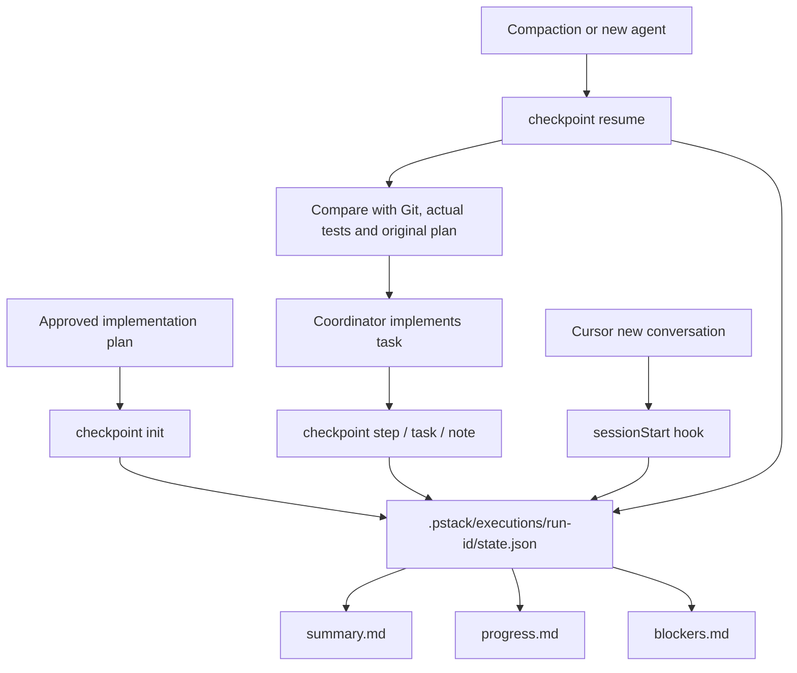

# PStack execution checkpoints

A lightweight integration modeled after the persisted-state mechanism of
[planning-with-files](https://github.com/OthmanAdi/planning-with-files).
The implementation is an original Python 3.9+ helper and an Agent Skill,
rather than a copy of planning-with-files or its hooks.

## Source evidence / architecture

REA's own
[reverse-engineer-anything skill](https://github.com/morluto/rea/blob/main/.agents/skills/reverse-engineer-anything/SKILL.md)
explicitly recommends ordinary repository inspection for complete source
repositories. This analysis traced source files directly; no REA MCP runtime
session or binary decompilation was performed.

- [PWF SKILL.md](https://github.com/OthmanAdi/planning-with-files/blob/master/skills/planning-with-files/SKILL.md):
  durable plan, findings, progress, and explicit resume from disk.
- [PWF Cursor setup](https://github.com/OthmanAdi/planning-with-files/blob/master/docs/cursor.md):
  session-start injection, post-edit reminders, and stop hooks.
- [PWF resolver](https://github.com/OthmanAdi/planning-with-files/blob/master/skills/planning-with-files/scripts/resolve-plan-dir.sh):
  pinned plan selection and guardrails against ambiguous roots.
- [PStack show-me-your-work](../../skills/show-me-your-work/SKILL.md):
  append-only decision audit, different from live execution state.
- [PStack session-pickup](../../skills/poteto-mode/playbooks/session-pickup.md):
  reconstruction from Git and prior transcripts.

Unlike planning-with-files, this integration stores all canonical execution
state for one run in `state.json`; its Markdown files are generated views.
The original approved `docs/plans/*.md` remains read-only.



## Usage

In the **working project**, determine the installed skill path. For OpenCode
it is normally `~/.agents/skills/execution-checkpoint/scripts/checkpoint.py`.
For Cursor with a project-local skill installation it is typically
`.cursor/skills/execution-checkpoint/scripts/checkpoint.py`.

```bash
CHECKPOINT="$HOME/.agents/skills/execution-checkpoint/scripts/checkpoint.py"

# Only after the plan has been explicitly approved for execution:
python3 "$CHECKPOINT" init --repo . --plan docs/plans/2026-11-22-feature.md --run feature

# During the work:
python3 "$CHECKPOINT" task --repo . --run feature --task T1 --status in_progress --next "T1/S1"
python3 "$CHECKPOINT" step --repo . --run feature --task T1 --step S1 --status complete --evidence "pytest tests/test_feature.py: PASS"
python3 "$CHECKPOINT" note --repo . --run feature --summary "T1/S1 verified" --next "T1/S2"
python3 "$CHECKPOINT" block --repo . --run feature --task T1 --message "CI unavailable" --evidence "job #42"
python3 "$CHECKPOINT" unblock --repo . --run feature --blocker B1 --resolution "CI restored"

# After context compaction, context reset, or a new conversation:
python3 "$CHECKPOINT" resume --repo . --run feature

# Optional: enable session-start and post-edit reminders in a Cursor project:
python3 "$CHECKPOINT" install-cursor-hooks --repo .
```

The tool parses `### Task 1: ...` and `### Phase 1: ...` into `T1`
and their checkboxes into `S1`, `S2`, and so on. Previously checked
boxes are not treated as proof of executed work. Completed steps/tasks
require nonempty evidence. The tool **does not** execute or verify the
evidence; the coordinator must run tests and compare with Git.

## Storage contract

```text
working-repo/
  docs/plans/2026-11-22-feature.md  # Approved plan
  .pstack/executions/feature/
    state.json                       # Canonical current state and events
    summary.md                      # Human-readable report and next action
    progress.md                     # Chronological actions and evidence
    blockers.md                     # Open and resolved blockers
```

This folder is inside the **repository being modified**, not in the
PStack plugin repository. Files may be committed to a feature branch for
cross-machine recovery, but are not automatically committed. Scrub
secrets and personal/production data before sharing.

## Safety and known limits

- Cursor `sessionStart` runs for a **new session**. It does not guarantee
  automatic reinjection on an in-place context compaction. Invoke
  `resume` after compaction and explicitly read persisted files.
- Multiple runs without `--run` or `PSTACK_RUN_ID` fail closed.
  Parallel writers must use one coordinator or separate worktrees.
- The original plan SHA-256 is recorded at initialization. Drift is
  reported on `status` or `resume`; reconcile scope via
  `plan-gap-interview` before continuing.
- Writing `state.json` is atomic; projections are regenerated after
  updates. The state file takes precedence if a crash interrupts
  regeneration of Markdown.
- No auto-continue stop hooks, no background work, no automatic Git writes,
  and no self-granted approval to execute destructive commands.
- The optional hook installer merges rather than replaces
  `.cursor/hooks.json`. It still modifies repository-local hook
  configuration; inspect the diff before committing.
- OpenCode relies on agent instructions and explicit CLI calls;
  Cursor hook setup is optional and separate.

## Test

```bash
python3 -m unittest discover -s skills/execution-checkpoint/tests -v
```
