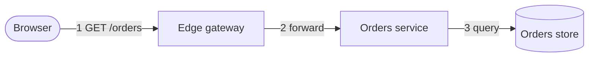

# Diagrams

One `flowchart` per step, built with mermaid. It must render on GitHub from the Markdown alone.

## Build-up rule

- Step 1 shows the two actors the idea starts with.
- Every later step redraws the whole previous diagram and adds exactly one part: a node, an edge, or a return path.
- Never remove a node between steps. Never redraw from scratch with a different layout.
- The last step is the complete picture.

The same node ids appear in the same order across steps, so the reader's eye does not re-learn the layout.

## Limits and syntax

- At most 15 nodes per step (lint rule 3).
- Plain nodes: `gateway[Edge gateway]`, `db[(Orders store)]`, `queue[[Work queue]]`.
- Labels in words the reader knows. No class names, file paths, or ticket numbers.
- Request flows number the edges: `-->|1 GET /orders|`.
- Use `flowchart LR` for flows, `flowchart TD` for pipelines. Keep one direction per diagram.
- Quote only when the label needs it, and write quotes as `#quot;` inside the label. Never use a backslash-escaped quote.
- No `click` statements. No `@{ icon: }`. No raw HTML. Interaction belongs to the renderer (lint rules 12 and 13).
- No colours or styles that carry meaning: `classDef` and `style` are not part of the lesson language.

## Node shapes

| Shape | Mermaid | Use for |
|---|---|---|
| Box | `[Label]` | A process, service, or gateway |
| Cylinder | `[(Label)]` | A database or store |
| Stadium | `([Label])` | A person or client |
| Subroutine | `[[Label]]` | A queue or buffer |
| Hexagon | `{{Label}}` | A decision or boundary |

Do not rely on shape alone. The label must say what the thing is.

## Matching the lesson

- Every Details id is a node in that step's diagram; every actor id is a node in at least one step.
- A scene may reference only nodes and edges that exist in that step's diagram.
- The diagram carries the structure. The prose carries the meaning. Do not put a paragraph in a node.

## Skeleton to copy

````markdown

````

## Patterns by idea

- **Request path:** left-to-right chain, numbered edges, return edges in the final step (`patterns/request-journey.md`).
- **Cache:** a branch from the gateway to a cache, then to the store on a miss (`patterns/cache-hit-miss.md`).
- **Queue:** producers into a buffer, workers out of it, a store behind the workers (`patterns/queue-under-load.md`).
- **Failover:** one client, a health check, a primary and a replica, with a switched edge (`patterns/failover.md`).
- **Fan-out:** one producer, a topic, several consumers, then their sinks (`patterns/fan-out.md`).
- **Rollout:** two versions behind one router, with a traffic edge (`patterns/rollout.md`).
- **Pipeline:** ordered stages, each feeding the next (`patterns/pipeline.md`).
- **Auth:** a user, a client, an identity provider, a token, and a protected resource (`patterns/auth-flow.md`).

## Check before moving on

- Count the nodes. Over 15 means split the step or drop a detail.
- Read the labels without the code. A newcomer should follow the arrow order.
- Compare with the previous step. Exactly one part is new.
- Confirm every Details id is present and every actor appears somewhere.