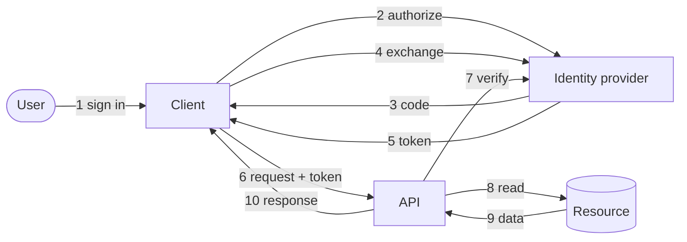

# Auth flow

Use when a token stands between a user and a protected resource and the reader
should see who issues, carries, and checks it.

## Metaphors

- A cloakroom ticket: the attendant issues it, and the counter checks it before
  handing back the coat.
- A passport check at a border: one authority issues it, another inspects it.
- A wristband at an event: the door staff check it, not the person who sold it.

## Roles

| Id | Role | Use |
|---|---|---|
| `user` | `user` | The person signing in |
| `client` | `client` | The app that holds the session |
| `idp` | `identity-provider` | The issuer of the token |
| `api` | `service` | The protected service |
| `resource` | `database` | The data behind the service |

## Diagram skeleton



The token is a value on an edge, not a node. Add a refresh edge only in the step
that explains expiry.

## Scene

```yaml
title: A valid token and an expired one
controls:
  - trigger: Call the API
  - toggle: { id: expired, label: Token is expired, default: false }
timeline:
  - packet: { from: client, to: api, label: request + token }
  - when: expired
    then:
      - state: { node: api, to: error }
      - packet: { from: api, to: client, label: 401 }
      - packet: { from: client, to: idp, label: refresh }
      - packet: { from: idp, to: client, label: new token }
    else:
      - state: { node: api, to: busy }
      - packet: { from: api, to: resource, label: read }
      - packet: { from: resource, to: api, label: data }
      - packet: { from: api, to: client, label: 200 }
narration:
  - at: 1
    text: The client sends the token with the request; the API checks it before reading.
  - at: 3
    text: An expired token stops at the API and sends the client back for a new one.
```

## What the reader controls

- **Trigger:** calls the API with the current token.
- **Toggle:** expires the token, so the API refuses and the client has to
  refresh before retrying.
- No slider: the lesson is about a yes/no check, not a rate.

## Suggested quiz

```yaml
question: Who checks that the token is valid on this request?
options:
  - The user
  - The client
  - The API
answer: The API
why: The identity provider issued the token, but the protected service must verify it before reading the resource.
```

Ask the reader to turn expiry on and trace how many hops the retry adds.