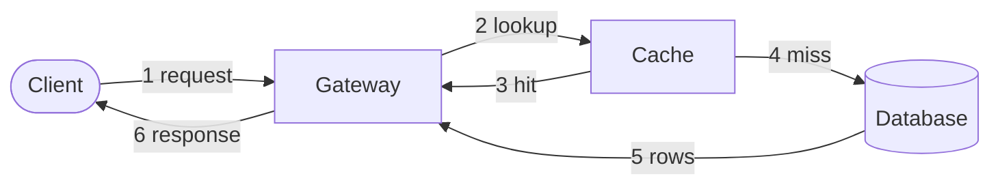

# Cache hit and miss

Use when a fast store sits in front of a slower one and the reader should see both outcomes from one control.

## Roles

| Id | Role | Use |
|---|---|---|
| `client` | `client` | The caller |
| `gateway` | `gateway` | The component that checks the cache first |
| `cache` | `cache` | The fast store |
| `database` | `database` | The slower source of truth |

## Diagram skeleton



Keep the cache branch as one node; the hit and miss paths are edges in the scene, not separate diagrams.

## Scene

```yaml
title: Cache miss versus hit
controls:
  - trigger: Send request
  - toggle: { id: cache, label: Cache warm, default: false }
  - slider: { id: rps, label: Requests per second, min: 1, max: 50, default: 5 }
timeline:
  - packet: { from: client, to: gateway, label: request }
  - state: { node: gateway, to: busy }
  - when: cache
    then:
      - packet: { from: gateway, to: cache, label: lookup, ms: 20 }
      - packet: { from: cache, to: gateway, label: hit, ms: 20 }
    else:
      - packet: { from: gateway, to: database, label: query, ms: 300 }
      - state: { node: database, to: busy }
      - packet: { from: database, to: gateway, label: rows, ms: 300 }
  - counter: { id: latency, label: Latency, sum: ms }
  - packet: { from: gateway, to: client, label: response }
narration:
  - at: 1
    text: The gateway checks the cache before it asks the database.
  - at: 4
    text: The toggle selects the branch, so the same request takes a different path.
```

## Suggested challenge

```yaml
goal: { counter: latency, below: 200 }
hint: The slow hop only disappears when the cache answers.
why: A cache lowers latency only when the hit rate removes the store from the common path.
```

Ask the reader to run once cold and once warm, then compare the counter.