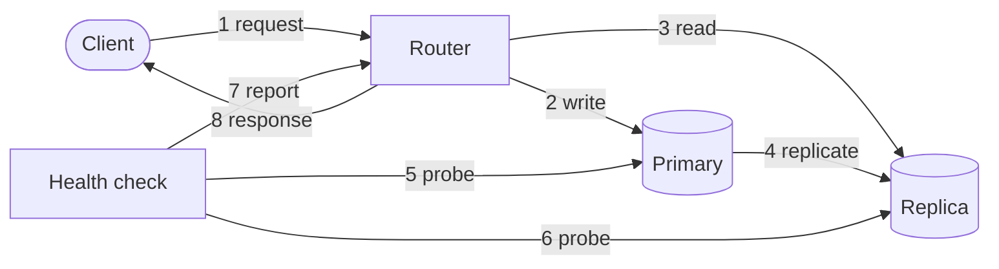

# Failover

Use when a primary handles writes, a replica can take over, and the reader
should see the switch and what it costs.

## Metaphors

- A spare tyre: it only matters when the road takes the first wheel.
- A backup singer who knows every line but may be a beat behind.
- Two keys to one door; the second key still opens it, but the room may be
  missing the last thing carried in.

## Roles

| Id | Role | Use |
|---|---|---|
| `client` | `client` | The caller |
| `lb` | `load-balancer` | The router that can change its target |
| `primary` | `database` | The write target |
| `replica` | `database` | The copy that can be promoted |
| `probe` | `service` | The health check that detects the failure |

## Diagram skeleton



Keep the probe as a node: it explains why the router can make a decision at all.

## Scene

```yaml
title: The primary stops answering
controls:
  - trigger: Send request
  - toggle: { id: primary-down, label: Primary is down, default: false }
timeline:
  - packet: { from: client, to: lb, label: request }
  - when: primary-down
    then:
      - state: { node: primary, to: error }
      - state: { node: probe, to: error }
      - packet: { from: probe, to: lb, label: unhealthy }
      - packet: { from: lb, to: replica, label: failover write }
      - state: { node: replica, to: busy }
    else:
      - packet: { from: lb, to: primary, label: write }
      - state: { node: primary, to: busy }
      - packet: { from: primary, to: replica, label: replicate }
  - packet: { from: lb, to: client, label: response }
narration:
  - at: 1
    text: The router sends writes to the primary while the probe reports healthy.
  - at: 4
    text: The probe fails, the router switches, and writes land on the replica.
```

## What the reader controls

- **Trigger:** sends one request through the router.
- **Toggle:** takes the primary down, so the probe fails and the router switches
  to the replica.
- No slider: the lesson is about a binary failure, not a rate.

## Suggested quiz

```yaml
question: What can be lost when the router switches to the replica?
options:
  - The schema
  - Writes that had not replicated yet
  - Read traffic
answer: Writes that had not replicated yet
why: The replica is behind by the replication lag, so a promotion can omit the newest writes.
```

Ask the reader to turn the toggle on mid-run and trace how the router learns
about the failure.