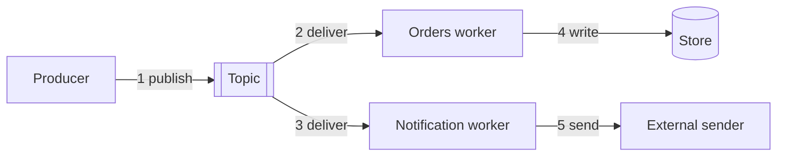

# Fan-out

Use when one event reaches several consumers and each can fail or fall behind on its own.

## Roles

| Id | Role | Use |
|---|---|---|
| `producer` | `service` | The component that publishes the event |
| `topic` | `queue` | The shared channel |
| `orders` | `worker` | The first consumer |
| `notify` | `worker` | The second consumer |
| `store` | `database` | The first consumer's sink |
| `sender` | `external` | The second consumer's outside target |

## Diagram skeleton



Two consumers are enough to show independence. Add a third only if the lesson explains a third behaviour.

## Scene

```yaml
title: One event, two consumers
controls:
  - trigger: Publish event
  - toggle: { id: notify-slow, label: Notification consumer is slow, default: false }
timeline:
  - packet: { from: producer, to: topic, label: event }
  - state: { node: topic, to: busy }
  - packet: { from: topic, to: orders, label: deliver }
  - packet: { from: orders, to: store, label: write }
  - when: notify-slow
    then:
      - state: { node: notify, to: queued }
      - counter: { id: backlog, label: Notification backlog, sum: count }
    else:
      - packet: { from: topic, to: notify, label: deliver }
      - packet: { from: notify, to: sender, label: send }
  - state: { node: orders, to: idle }
narration:
  - at: 1
    text: The producer publishes once; the channel copies the event to each consumer.
  - at: 4
    text: A slow consumer builds its own backlog without stopping the other.
```

## Suggested quiz

```yaml
question: The notification consumer stops. What happens to the orders consumer?
options:
  - It stops too
  - It keeps processing
  - It replays the event
answer: It keeps processing
why: Each consumer reads independently, so one backlog does not block the other.
```

The counter is also the challenge: keep the notification backlog below the budget while publishing.