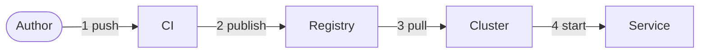

# Pipeline

Use when work moves through ordered stages and each stage can stop the next one.

## Roles

| Id | Role | Use |
|---|---|---|
| `author` | `user` | The person who pushes the change |
| `ci` | `ci` | Build and test runner |
| `registry` | `registry` | Where the artifact is published |
| `cluster` | `cluster` | The runtime that pulls the artifact |
| `service` | `service` | The workload that starts |

## Diagram skeleton



If the lesson needs a separate test node, add it between `ci` and `registry` and give it the `ci` role.

## Stage

```yaml
title: A change reaches the cluster
stage:
  grid: [12, 6]
  place:
    - { actor: author, at: [1, 3] }
    - { actor: ci, at: [4, 3] }
    - { actor: registry, at: [7, 3] }
    - { actor: cluster, at: [10, 3] }
controls:
  - trigger: Push commit
  - toggle: { id: tests-pass, label: Tests pass, default: true }
timeline:
  - spawn: { token: request, from: author, to: ci, every: 10 }
  - state: { node: ci, to: busy }
  - when: tests-pass
    then:
      - packet: { from: ci, to: registry, label: publish }
      - state: { node: registry, to: busy }
      - packet: { from: registry, to: cluster, label: pull }
      - state: { node: cluster, to: busy }
      - bubble: { on: cluster, text: "Started" }
    else:
      - state: { node: ci, to: error }
      - bubble: { on: ci, text: "Checks failed" }
  - counter: { id: duration, label: Pipeline time, sum: ms }
narration:
  - at: 1
    text: The commit enters the runner, which builds and tests one artifact.
  - at: 5
    text: Only a passing artifact is published, pulled, and started.
```

## Suggested quiz

```yaml
question: Where should a failing test stop the pipeline?
options:
  - Before the artifact is published
  - After the cluster pulls it
  - After the service starts
answer: Before the artifact is published
why: Publishing a bad artifact lets other stages consume it, so the gate belongs before the registry.
```

Order variant: push, build, test, publish, pull, start. Use `pipeline` when the reader must remember the gate, not the components.