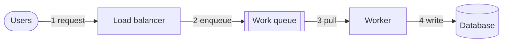

# Queue under load

Use when the lesson is about buffering, backpressure, and what happens when arrivals outpace workers.

## Roles

| Id | Role | Use |
|---|---|---|
| `users` | `user` | The source of work |
| `lb` | `load-balancer` | The front door that admits traffic |
| `queue` | `queue` | The buffer |
| `worker` | `worker` | The consumer that drains the buffer |
| `database` | `database` | The durable sink |

## Diagram skeleton



Show the queue depth as a scene state, not as extra nodes. One worker node stands for the fleet.

## Stage

```yaml
title: Why the queue grows
stage:
  grid: [12, 6]
  place:
    - { actor: users, at: [1, 3] }
    - { actor: lb, at: [4, 3] }
    - { actor: queue, at: [7, 3] }
    - { actor: worker, at: [10, 3] }
controls:
  - slider: { id: rps, label: Requests per second, min: 1, max: 100, default: 10 }
  - trigger: Drain the queue
timeline:
  - spawn: { token: request, from: users, to: lb, every: rps }
  - move: { token: request, from: lb, to: queue }
  - when: { rps: ">60" }
    then:
      - state: { node: worker, to: queued }
      - bubble: { on: queue, text: "Depth: {queue}" }
      - counter: { id: queue, label: Queue depth, sum: request }
    else:
      - move: { token: request, from: queue, to: worker }
      - state: { node: worker, to: busy }
narration:
  - at: 1
    text: Each tick adds one request at the rate the slider sets.
  - at: 3
    text: Above the worker's capacity, the buffer grows instead of the throughput.
```

## Suggested challenge

```yaml
goal: { counter: queue, below: 20 }
hint: Depth falls only when arrivals stop outrunning the worker.
why: A queue absorbs bursts, but sustained arrivals above capacity grow without bound.
```

Follow with a quiz: what does a growing depth tell you about the worker, not the users?