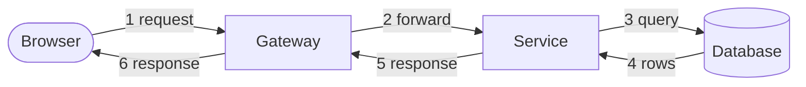

# Request journey

Use when one request crosses several components and the reader should see each hop and the return path.

## Roles

| Id | Role | Use |
|---|---|---|
| `client` | `client` | The browser, app, or CLI that starts the request |
| `gateway` | `gateway` | The entry point that admits and routes |
| `service` | `service` | The component that owns the behaviour |
| `database` | `database` | The store the service reads and writes |

## Diagram skeleton



Add the return edges only in the step that explains the response. Earlier steps stop at the store.

## Scene

```yaml
title: Where the request spends its time
controls:
  - trigger: Send request
  - toggle: { id: database, label: Store is slow, default: false }
timeline:
  - packet: { from: client, to: gateway, label: request }
  - state: { node: gateway, to: busy }
  - packet: { from: gateway, to: service, label: forward }
  - packet: { from: service, to: database, label: query, ms: 200 }
  - when: database
    then:
      - state: { node: database, to: busy }
      - packet: { from: database, to: service, label: rows, ms: 900 }
    else:
      - packet: { from: database, to: service, label: rows, ms: 40 }
  - counter: { id: latency, label: Latency, sum: ms }
  - packet: { from: service, to: gateway, label: response }
  - packet: { from: gateway, to: client, label: response }
narration:
  - at: 1
    text: The gateway admits the request and the service asks the store.
  - at: 5
    text: The same path carries the response back.
```

## Suggested quiz

```yaml
question: Which component turns stored rows into the response?
options:
  - The client
  - The gateway
  - The service
answer: The service
why: The store returns rows; the service owns the shape of the response.
```

Use the hop count as the challenge variant: keep latency under a budget by leaving the slow toggle off.