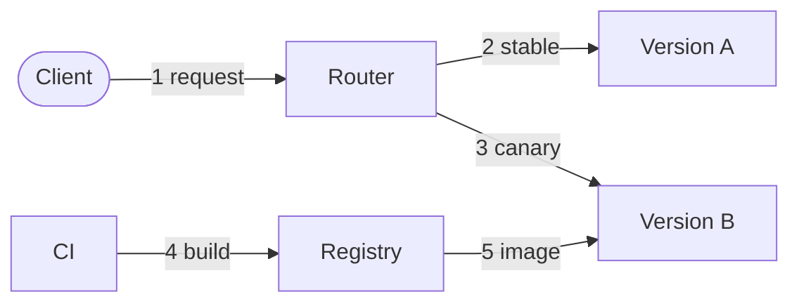

# Rollout

Use when two versions run side by side and traffic moves between them, with a rollback path.

## Roles

| Id | Role | Use |
|---|---|---|
| `client` | `client` | The caller |
| `router` | `load-balancer` | The component that splits traffic |
| `old` | `service` | The version serving most traffic |
| `new` | `service` | The version receiving the new share |
| `ci` | `ci` | The builder |
| `registry` | `registry` | Where the built artifact lives |

## Diagram skeleton



The build path explains what the new version runs. Keep it out of the traffic diagram only when a previous step already showed it.

## Stage

```yaml
title: Moving traffic to the new version
stage:
  grid: [12, 6]
  place:
    - { actor: client, at: [1, 3] }
    - { actor: router, at: [4, 3] }
    - { actor: old, at: [8, 2] }
    - { actor: new, at: [8, 4] }
controls:
  - slider: { id: share, label: New version share, min: 0, max: 100, default: 10 }
  - trigger: Send traffic
timeline:
  - spawn: { token: request, from: client, to: router, every: 10 }
  - when: { share: ">0" }
    then:
      - move: { token: request, from: router, to: new }
      - state: { node: new, to: busy }
  - when: { share: "<100" }
    then:
      - move: { token: request, from: router, to: old }
      - state: { node: old, to: busy }
  - when: { share: ">50" }
    then:
      - bubble: { on: new, text: "Share: {share}%" }
  - counter: { id: errors, label: Errors, sum: count }
narration:
  - at: 1
    text: The slider is the traffic split; the router sends each request to one version.
  - at: 4
    text: Raising the share moves more requests without restarting either version.
```

## Suggested challenge

```yaml
goal: { counter: errors, below: 5 }
hint: Move the share in small steps and watch the error counter between runs.
why: A rollout is safe only while the new version's error rate stays inside its budget.
```

Quiz variant: "The new version starts failing. What is the fastest safe action?" Answer: set the share back to zero and roll back, not restart the old version.