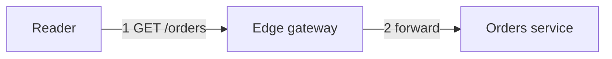

# Plain and technical

This is the default profile. Every step explains its idea twice: first in
everyday words, then in technical terms. Both layers are required on every step;
this is not an option. A lay reader can stop after the first layer and still
follow the story; the second layer makes the same idea precise.

The machine rules are in `$HUB/profiles/plain-and-technical.json`: one layer
from each group, in order, on every step, and 3–8 steps.

## Markers

Write the pair in the lesson's language, which is the language of the user's
request. Do not mix languages in one step or across steps.

- Indonesian: `> **Sederhananya:** …` then `> **Secara teknis:** …`
- English: `> **In plain words:** …` then `> **Technically:** …`

The parser accepts either pair. Each is a single line, placed directly after
the heading and the `> **Type:**` line, before `> **Key idea:**`.

## The plain layer

- Open the step's explanation with it. The `Type` tag may sit above it.
- Use an everyday picture: a post office, a kitchen, a queue at a counter, a
  shelf, a relay race.
- Use no jargon. If a term needs a definition, it does not belong here.
- Say what happens, who does it, and why, in one or two sentences. Keep it true;
  a simple picture is not a licence to say something false.
- Prefer one analogy world for the whole lesson. Reusing the same post office,
  kitchen, or queue lets the reader carry one picture from step to step.
- Say where the analogy stops holding. One sentence is enough: "A real post
  office has one clerk; the gateway serves thousands of requests at once." Put
  it in the intro, or in the step where the difference matters.

## The technical layer

- Follow the plain layer immediately.
- Name the precise terms the code and the team use: HTTP request, API gateway,
  orders service, database query, JSON.
- Tie each term back to the analogy in the same sentence. "The API gateway (the
  front counter) reads the path and routes the request."
- Use the names from the repo, not invented synonyms. One name per concept for
  the whole lesson.
- Keep it to one or two sentences. Precision does not need length; the detail
  goes in the Details list.
- Do not repeat the plain layer. Add what the analogy could not say: the
  protocol, the owner of the data, the failure mode, the number.

## Scene narration and bubbles

Where it helps, let the scene speak the analogy's language.

- `narration` may use the same picture: "The front counter admits the order
  slip."
- `bubble` text may be short and human: "Queue: {queue}".
- Diagram labels stay the real names. Do not rename an actor to the analogy.

## Worked step (invented content)

````markdown
## Step 2: The front counter passes the slip to the back room

> **Type:** technique
> **In plain words:** The front counter cannot fill an order itself, so it walks the slip to the back room that keeps the order cards.
> **Technically:** The API gateway forwards the HTTP request to the orders service, which owns the order data. The front counter is the gateway; the back room is the service.
> **Key idea:** Each hop hands the request to the component that owns the next piece of work.

The orders service is the only part that keeps order data, so the gateway forwards the request to it. The post office picture stops here: the real service answers many requests at once and keeps no paper.



**Details**

- **client**: Waits for the order list.
- **gateway**: Reads the path and chooses the service.
- **service**: Owns the order list and builds the response.
````

The step keeps the real names in the diagram and Details, and uses the post
office only in the two layers. A scene on this step would narrate "The front
counter admits the order slip and passes it to the back room."

## Check

- Every step has both markers, in order, in one language.
- The plain layer would make sense to someone who has never opened a terminal.
- The technical layer names each precise term and ties it to the picture.
- The same analogy world returns across steps, and the text says where it stops.
- The lesson has 3–8 steps.