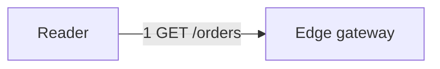
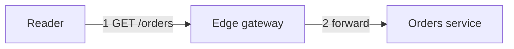
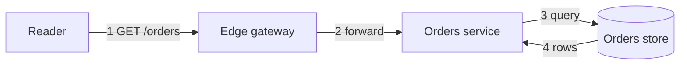
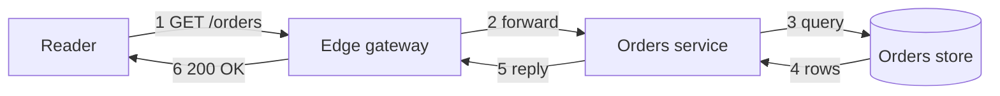

Think of a post office. You hand an order slip to the front counter. The clerk
walks it to the back room, and the back room keeps the order cards in a filing
cabinet. The picture stops at one counter and one clerk: in this system one
gateway serves many requests at once, and the filing cabinet is a database.
By the end you will know which part touches the request at each hop.

## Step 1: A reader asks for the order list

> **Type:** problem
> **In plain words:** You hand one order slip to the front counter. The clerk accepts it and puts it in line for the back room.
> **Technically:** The client sends one HTTP request. The API gateway accepts it, validates its shape, and holds it for routing. The front counter is the gateway.
> **Key idea:** The gateway is the first component that reads the request.

The reader starts the journey with one request. The edge gateway is the only
part that accepts traffic from outside, so every request passes through it.



**Details**

- **client**: Sends one request for the order list and waits for the reply.
- **gateway**: Accepts the request and checks its shape before routing.

## Step 2: The front counter forwards to the back room

> **Type:** technique
> **In plain words:** The front counter cannot fill the order itself, so it walks the slip to the back room that keeps the order cards.
> **Technically:** The API gateway forwards the HTTP request to the orders service, which owns the order data. The front counter is the gateway; the back room is the service.
> **Key idea:** Each hop hands the request to the component that owns the next piece of work.

The gateway does not own order data, so it hands the request to the orders
service. From here on, the service decides what the reply contains.



**Details**

- **client**: Still waits; the reader sees nothing yet.
- **gateway**: Chooses the service from the path and stops reading the request.
- **service**: Owns the order list and starts building the reply.

## Step 3: The back room opens the filing cabinet

> **Type:** tradeoff
> **In plain words:** The back room opens the filing cabinet, finds your order card, and copies the lines onto a reply. A slow cabinet makes the whole line wait.
> **Technically:** The orders service issues a database query and waits for the rows before it can shape JSON. The filing cabinet is the database; a slow query holds the reply.
> **Key idea:** The database call is usually the slowest hop, so it decides the response time.

The service asks the store for the rows. The store returns data, not a reply:
the service still has to choose the fields and the shape. In the scene, the
slow-store toggle lengthens the store hop, the rate slider turns the store
queued above 30 requests per second, and the latency counter adds each hop.



**Details**

- **client**: Waits for the full reply.
- **gateway**: Keeps the connection open while the service works.
- **service**: Queries the store and maps rows to the reply shape.
- **db**: Returns the matching rows in one batch.

```quiz
question: Which component turns stored rows into the reply?
options:
  - The reader
  - The edge gateway
  - The orders service
answer: The orders service
why: The store returns rows; the service decides which fields the reply carries.
```

```scene
title: Where the request waits
controls:
  - trigger: Send request
  - toggle: { id: slow-db, label: Store is slow, default: false }
  - slider: { id: rps, label: Requests per second, min: 1, max: 40, default: 5 }
timeline:
  - packet: { from: client, to: gateway, label: GET /orders }
  - state: { node: gateway, to: busy }
  - packet: { from: gateway, to: service, label: forward }
  - packet: { from: service, to: db, label: query, ms: 200 }
  - when: slow-db
    then:
      - state: { node: db, to: busy }
      - packet: { from: db, to: service, label: rows, ms: 900 }
    else:
      - packet: { from: db, to: service, label: rows, ms: 40 }
  - gauge: { node: db, value: rps }
  - when: { rps: ">30" }
    then:
      - state: { node: db, to: queued }
  - counter: { id: latency, label: Latency, sum: ms }
narration:
  - at: 1
    text: The front counter admits the request and the back room asks the filing cabinet.
  - at: 5
    text: The slow-store toggle makes the same request wait longer.
```

## Step 4: The reply retraces the hops

> **Type:** recap
> **In plain words:** The reply comes back through the same desks. The back room hands it to the front counter, and the front counter gives it to you.
> **Technically:** The service shapes the rows into JSON; the gateway adds response headers and returns 200 OK to the client. The response retraces the request path in reverse.
> **Key idea:** The response follows the same path backward; each hop adds or removes only its own part.

The response is not a new journey. It follows the same components in reverse,
and each one adds or removes its part before the reader sees the page. The
scene replays the whole path as a stream: each token is one order slip, and the
front counter shows its queue. The slider sets the rate; above 12 per second the
front counter turns queued.



**Details**

- **client**: Renders the order list the reader asked for.
- **gateway**: Adds the response headers and returns the reply to the reader.
- **service**: Shapes the rows into the response body.
- **db**: Has no further part after it returns the rows.

```scene
title: One request crosses the post office
stage:
  grid: [12, 6]
  place:
    - { actor: client, at: [1, 3] }
    - { actor: gateway, at: [4, 3] }
    - { actor: service, at: [7, 3] }
    - { actor: db, at: [10, 3] }
controls:
  - trigger: Send requests
  - slider: { id: rate, label: Requests per second, min: 1, max: 20, default: 5 }
timeline:
  - spawn: { token: request, from: client, to: gateway, every: rate }
  - bubble: { on: gateway, text: "Queue: {queue}" }
  - when: { rate: ">12" }
    then:
      - state: { node: gateway, to: queued }
      - glow: { on: gateway }
narration:
  - at: 1
    text: Each token is one order slip still in flight at the front counter.
```

## Recap

- The reader asks the gateway for the order list.
- The gateway forwards to the orders service, which owns the reply.
- The service reads rows from the store, the slowest hop.
- The reply retraces the same hops, and only the reader renders the list.