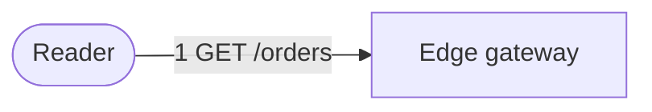
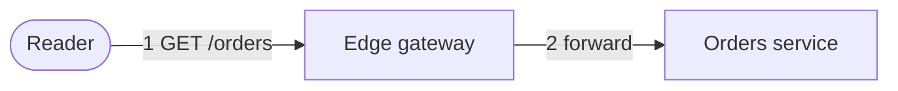
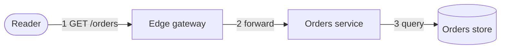
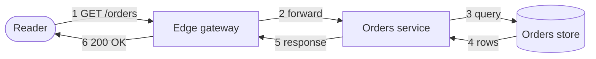

This lesson follows one request for the order list from a reader to the orders
store and back. By the end you will know which component admits the request,
which one owns the response, where the data is read, and why the return path
matters.

## Step 1: A reader asks for the order list

The reader starts the journey with one request. The edge gateway is the only
component that accepts traffic from outside, so every request passes through it
before anything else sees it.



**Details**

- **client**: Sends one request for the order list and waits for the response.
- **gateway**: Accepts the request and reads its path before choosing a target.

## Step 2: The gateway forwards to the service

The gateway does not own order data, so it hands the request to the orders
service. From here on, the service decides what the response contains.



**Details**

- **client**: Still waits; the reader sees nothing yet.
- **gateway**: Chooses the service from the path and stops reading the request.
- **service**: Owns the order list and starts building the response.

## Step 3: The service reads the store

The service asks the store for the rows. The store returns data, not a
response: the service still has to choose the fields and the shape.



**Details**

- **client**: Waits for the full response.
- **gateway**: Keeps the connection open while the service works.
- **service**: Queries the store and maps rows to the response shape.
- **db**: Returns the matching rows in one batch.

```quiz
question: Which component turns stored rows into the response?
options:
  - The reader
  - The edge gateway
  - The orders service
answer: The orders service
why: The store returns rows; the service decides which fields the response carries.
```

```scene
title: Where the request waits
controls:
  - trigger: Send request
  - toggle: { id: db, label: Store is slow, default: false }
timeline:
  - packet: { from: client, to: gateway, label: GET /orders }
  - state: { node: gateway, to: busy }
  - packet: { from: gateway, to: service, label: forward }
  - packet: { from: service, to: db, label: query, ms: 200 }
  - when: db
    then:
      - state: { node: db, to: busy }
      - packet: { from: db, to: service, label: rows, ms: 900 }
    else:
      - packet: { from: db, to: service, label: rows, ms: 40 }
  - counter: { id: latency, label: Latency, sum: ms }
  - packet: { from: service, to: gateway, label: response }
  - packet: { from: gateway, to: client, label: 200 OK }
narration:
  - at: 1
    text: The gateway admits the request and the service asks the store.
  - at: 5
    text: The toggle makes the store slow, so the same request waits longer.
```

## Step 4: The response retraces the hops

The response is not a new journey. It follows the same components in reverse,
and each one adds or removes its part before the reader sees the page.



**Details**

- **client**: Renders the order list the reader asked for.
- **gateway**: Adds the response metadata and returns it to the reader.
- **service**: Shapes the rows into the response body.
- **db**: Has no further part after it returns the rows.

```scene
title: One request and one response
stage:
  grid: [12, 6]
  place:
    - { actor: client, at: [1, 3] }
    - { actor: gateway, at: [4, 3] }
    - { actor: service, at: [7, 3] }
    - { actor: db, at: [10, 3] }
controls:
  - trigger: Send request
  - slider: { id: rps, label: Requests per second, min: 1, max: 40, default: 5 }
timeline:
  - spawn: { token: request, from: client, to: gateway, every: rps }
  - move: { token: request, from: gateway, to: service }
  - move: { token: request, from: service, to: db }
  - appear: { on: service, label: response }
  - move: { token: response, from: service, to: gateway }
  - move: { token: response, from: gateway, to: client }
  - when: { rps: ">25" }
    then:
      - state: { node: gateway, to: queued }
      - bubble: { on: gateway, text: "In flight: {inflight}" }
narration:
  - at: 1
    text: Each tick sends one request along the row of actors.
  - at: 4
    text: The response turns around and retraces the hops to the reader.
```

## Recap

- The reader asks through the edge gateway.
- The gateway forwards to the orders service, which owns the response.
- The service reads rows from the store.
- The response retraces the same hops, and only the reader renders the list.